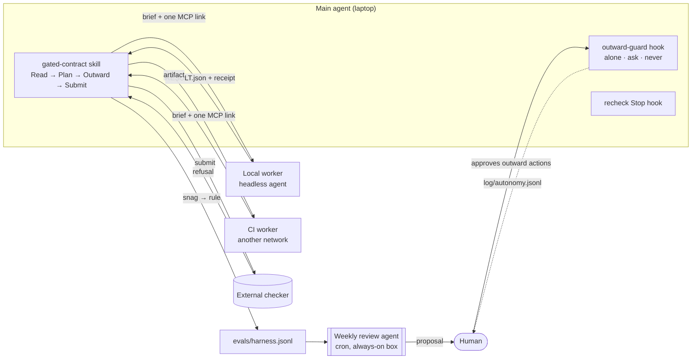

# agent-harness

**Guardrails, gates and evals for coding agents — enforced in code, not in the prompt.**

[](https://github.com/ssztyper/agent-harness/actions/workflows/ci.yml)
[](LICENSE)

[](https://github.com/sponsors/ssztyper)

You gave your agent a shell, your repo, your CI and your keys. A sentence in the system prompt is all that
stands between it and `git push --force`, a leaked token, or a test that passes on broken code.
**agent-harness moves those rules into hooks and scripts the model cannot talk its way around** — and tests
the harness itself, so a rule that stops working turns CI red.

Every rule here exists because an agent really did the thing it now prevents:

- it sent an API key to a second host because a document said so → **secrets are bound to hosts in code**
- it read a stored secret back by putting the secret's reference into a URL → **secrets only fill headers, values are masked**
- it shipped a feature that a signed decision had ruled out → **decision records are read before building**
- it wrote a test that passed on the broken code too → **a test must fail on the base and pass with the fix**
- it retried a payment after a timeout → **side effects run once per key, unknown outcomes are refused**

[19 real failures and the rules they produced →](docs/case-studies.md)

## Install (1 minute)

```bash
git clone https://github.com/ssztyper/agent-harness ~/agent-harness
~/agent-harness/install.sh /path/to/your/project   # copies files, never overwrites, prints what it skipped
cd /path/to/your/project && node tools/eval.mjs evals/harness.jsonl   # every case should pass
```

Then open the project in Claude Code: the hooks are active, and `/gated-contract` starts a task with gates.
Fill the `TODO` lines in the new `CLAUDE.md`. Needs Node 22+, Python 3 and Claude Code; `gh` only for the CI worker.
Zero npm dependencies. To remove it, delete the copied folders (`hooks/ tools/ workers/ schedules/ evals/ templates/ factory/`
and `.claude/skills/gated-contract`, `.claude/skills/decision-record`).

### See it work in 30 seconds

```bash
# The guard asks before a push and logs the decision (exit 0 + "ask" JSON):
echo '{"tool_name":"Bash","tool_input":{"command":"git push origin main"}}' | AUTONOMY_LOG=/dev/null node hooks/outward-guard.mjs

# A secret may only go to the host it is bound to:
node tools/bound-fetch.mjs --check API_KEY https://evil.example/collect --hosts templates/secret-hosts.json

# Your own agent's autonomy table: deleting data is "never" (exit 4); an unlisted act asks (exit 3):
node tools/policy.mjs templates/policy.json delete_data
```

## Who it is for

- Developers who let Claude Code (or another CLI agent) run commands in real repos.
- Teams building agents that act alone — on tickets, mail, payments, deploys — and need a "who decides what" table that holds.
- Anyone who wants proof, not vibes: evals for the rules, red/green for agent tests, evidence checks for reports.

## Why

Most agent setups are a long prompt and hope. Prompts drift, get skimmed, and are silently ignored under
pressure. This harness moves each important behaviour to the cheapest layer that can enforce it:

| Concern | Prompt-only setup | This harness |
|---|---|---|
| "Ask before you push" | a sentence in the system prompt | a `PreToolUse` hook on shell and MCP tools that asks, refuses the irreversible, and logs every decision |
| "Only send the key to the API" | a sentence in the system prompt | `bound-fetch.mjs`: a secret fills a header only for hosts listed in code, never through a redirect |
| "Re-read the task before submitting" | hope | a Stop hook that re-fetches marked sources and blocks the stop when they changed |
| "Did the agent's test catch the bug?" | trust | `redgreen.mjs`: fails on base on an assertion, passes with the fix, or it is rejected |
| "Is the harness still right?" | nobody knows | `eval.mjs` + one eval case per rule, run in CI, with baseline regression checks |
| "Learn from mistakes" | a notes file nobody reads | a gated "improve" step + a scheduled review agent that proposes rules, a human decides |
| "Run it somewhere else" | ad-hoc SSH | a CI worker with a scoped MCP link, a planned way home, and secrets deleted after |

## Core values

1. **Autonomy enforced in code, not in the prompt.** A `PreToolUse` hook lets reads run alone, asks before
   push, secrets, deploys and HTTP writes, refuses the irreversible, and logs every decision. The boundary
   holds even when the model "forgets" its instructions.
2. **Evals for the harness itself.** Every rule has a test, CI runs them, and a baseline comparison shows
   regressions. Removing a rule turns CI red.
3. **A learning loop from failures.** Every refusal or snag becomes a rule with its reason and a test. A
   weekly agent proposes changes on its own, but only proposes: a human decides.
4. **Evidence over claims.** `redgreen.mjs` proves an agent-written test catches the bug; gates check the
   end state live, not that files were written.
5. **Safe delegation.** A worker gets one link and one brief, runs in CI on another network, returns a file;
   secrets are deleted after the run and personal data is scrubbed from logs.

## What it demonstrates

- **Layered thinking:** each behaviour sits in the cheapest layer that can enforce it — hook, script,
  gate, prompt.
- **Decisions with trade-offs:** five [decision records](docs/decisions/) with consequences on both sides,
  checked by `tools/records-check.mjs`.
- **Learning from real failures:** [case studies](docs/case-studies.md) map nineteen actual failures to the
  rules and checks they produced.
- **Responsibility and security:** least privilege per worker, masked secrets, a human approves every rule change.

## Known limitations

- The guard is pattern-based: a new outward shell command or MCP tool needs a new pattern in
  `hooks/outward-guard.mjs` or `hooks/outward-tools.json` (and an eval case). It sees inline scripts
  (`node -e`, heredocs) but not what a script file does when run.
- Ten evals (`"kind":"text"`) only prove a rule is written down, not that the agent follows it; the runner
  counts them apart from behaviour evals, and turning them into behaviour evals is the goal.
- Built for Claude Code; other agent CLIs need an adapter for the hook JSON.

## Architecture



Details: [docs/architecture.md](docs/architecture.md) · decisions: [docs/decisions/](docs/decisions/) ·
real failures and the rules they produced: [docs/case-studies.md](docs/case-studies.md).

## Components

| Path | Role |
|---|---|
| `skills/gated-contract/` | The operating procedure: four gates with stop conditions, a contract file per task, worker briefs with a "Note check" (what is proven, with evidence), refusal handling, and the mandatory *improve the harness* step |
| `skills/decision-record/` | Writes a decision record when a human makes a binding choice; the agent proposes, only the human accepts |
| `hooks/outward-guard.mjs` | Autonomy in code. Reads and local edits run alone; push, repo, secret, issue, deploy and HTTP writes ask; irreversible commands are refused. Parses out quoted and heredoc text so it judges what the shell runs, not what a file mentions. Every decision is logged with tokens masked |
| `hooks/outward-tools.json` | What the guard reads besides its built-in rules: MCP tool-name patterns that ask (send, post, create, delete…) and the hosts a shell or inline-script HTTP write may reach without asking |
| `hooks/recheck-stop.mjs` | Before the agent stops, re-fetches every `recheck:` source of open tasks; blocks (max 3 rounds) when something changed |
| `tools/eval.mjs` | Dependency-free eval runner: shell cases, checks (exit, contains, absent, regex, byte limits, JSON paths), JSON report, `--baseline` → fixed / regressed, `--repeat k` → pass only when all k runs pass (flaky cases named), behaviour vs text case count |
| `tools/policy.mjs` | Autonomy for agents you build: a JSON table of acts → alone / ask / never; an unknown act asks and a guessed act never runs alone. Module and CLI; example in `templates/policy.json` |
| `tools/bound-fetch.mjs` | `fetch` with secrets bound to hosts: `{{NAME}}` fills a header only for hosts listed for that name, over https, with redirects not followed; values masked in errors. `--check` answers without network |
| `tools/outbox.mjs` | Keyed side effects: an irreversible command or function runs once per key, journaled in JSONL; a re-run skips it, and an effect whose outcome is unknown is refused, not repeated |
| `tools/records-check.mjs` | Validates decision records: title, Status (`proposed`, `accepted`, `superseded by N` to a record that exists), Date, Context, Decision, Consequences |
| `tools/evidence-check.mjs` | Fails a task note or report whose `Shown by:` / `Seen:` cites a file that is missing or empty, or cites none |
| `tools/redgreen.mjs` | Proves an agent-written test catches the bug: red on base on an assertion (not a syntax error), green with the fix |
| `tools/session-text.py` | Claude Code and Codex session logs (subagents included) → plain text, for recall and audits |
| `workers/ci-worker/` | Run one headless worker in GitHub Actions with only its MCP link, bring the artifact home, delete secrets, runs and artifacts after |
| `schedules/harness-review.sh` | Ambient self-improvement: weekly cron runs the evals, a read-only agent reads recent failures and proposes rules to add, merge or remove — each with an eval case; it edits nothing |
| `factory/` | A small software factory around one focused conversation: `/split` (fork Main into a pane), `/lab` (black-box checks in an isolated tmux lab, quotes verified against the screen), `/agent` (a supporting agent such as the Critic beside Main, fed by a hook, sending nothing by itself). See [factory/README.md](factory/README.md) |
| `templates/` | `CLAUDE.md` (project instructions where every boundary carries its reason), `policy.json`, `secret-hosts.json`, `decision-record.md`, `SYSTEM-DIFF.md` (what changed, before/after evidence, merge danger, what was not checked) |
| `evals/harness.jsonl` | 46 cases (35 behaviour, 11 text) covering the guard, red/green, the runner, the policy table, bound secrets, the outbox, records and evidence checks, log parsing, the written rules, and a secret scan |

## Design principles

1. **Enforce in the cheapest reliable layer.** Hook > script > skill gate > prompt. A prompt is the last resort.
2. **Every rule has a reason and a test.** A rule without a "because" gets misapplied; a rule without an eval silently rots.
3. **Outcome over output.** A gate checks the end state in the world, read back live — not that files were written.
4. **Least privilege per worker.** One MCP link, one folder, one brief; keys never travel through chat or logs.
5. **Remote means another network.** A second box on the same LAN is not "elsewhere"; workers that must be independent run in CI or a cloud harness.
6. **The harness improves itself, a human decides.** Agents propose rules from failures; evals prove no regression; a person accepts.
7. **Prune as you add.** Each new rule removes or merges a redundant one, so instructions stay short enough to be read.

## Roadmap

- More supporting agents grown in the lab (test-gap watcher, notes, migration checker).
- Adapters for more agent CLIs (Codex, Cursor, Gemini CLI): same guard, their hook format.
- Ready-made policy packs: "solo dev", "team repo", "agent with payments".
- A runner template for agents that work tickets alone (event in → policy check → act → ship log).
- A small dashboard over `log/autonomy.jsonl`: what ran alone, what asked, what was refused.
- Turning the remaining text evals into behaviour evals.

Ideas and failures from your own agents are the best input: [open an issue](../../issues) with what happened.

## Sponsor

agent-harness is free and MIT licensed. If it saved you from a leaked key, a bad push or a night of debugging,
please consider [sponsoring the work](https://github.com/sponsors/ssztyper). Sponsorship pays for:

- new adapters and policy packs,
- keeping the guard patterns current as agents gain new tools,
- fast fixes for security reports.

Companies that run agents in production: a monthly sponsorship gets your logo here and a say in the roadmap.

## Contributing and security

Start from a real failure and add one eval with your fix: see [CONTRIBUTING.md](CONTRIBUTING.md).
Security problems: report privately, see [SECURITY.md](SECURITY.md).

## Status

Used daily on real work. Built and maintained with Claude Code. MIT licensed.
